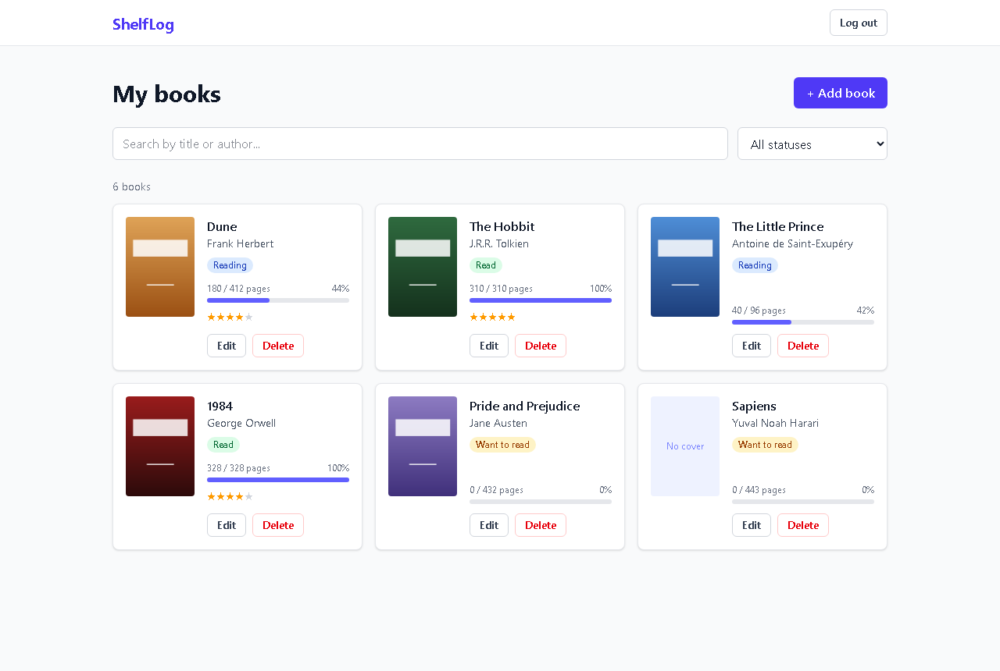
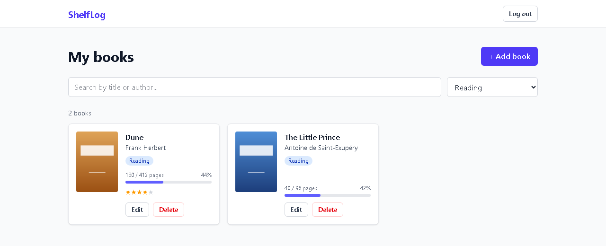
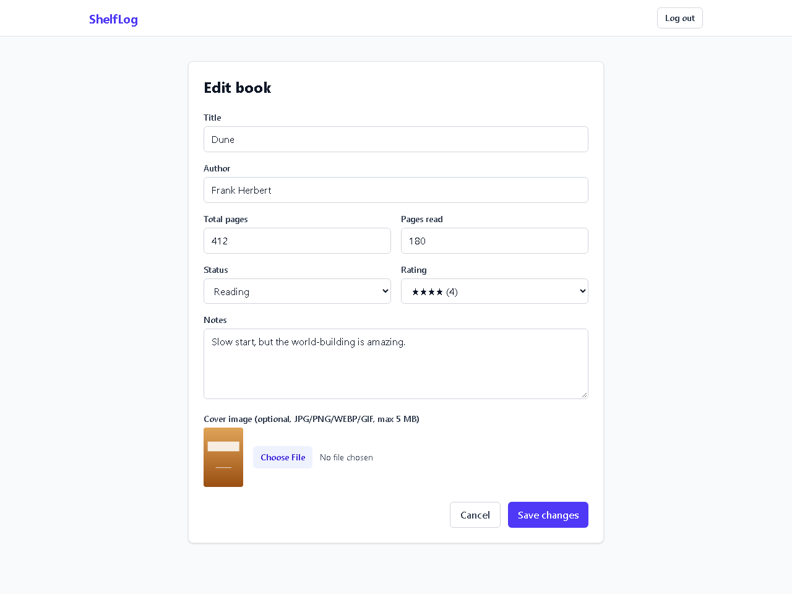
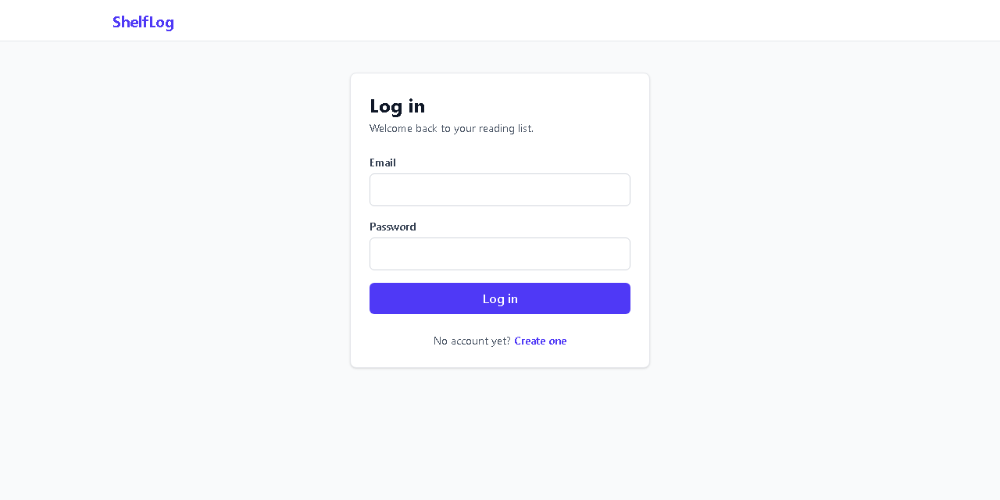
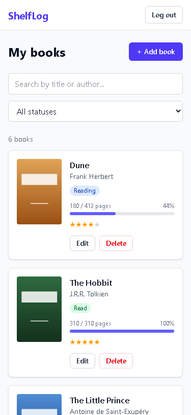

# 📚 ShelfLog – Personal Book Tracker

ShelfLog is a web application that helps readers keep track of their personal reading. Users can register, add books to their personal shelf and organise them by status: **read**, **reading** or **planned**. For each book they can record reading progress, a rating and personal notes. The app is aimed at hobby readers and students who want a simple, private place to manage their reading lists.

> Semester project for the courses *Web Application* and *Web Programming*.

## ✨ Features

- User registration and login (JWT authentication)
- Add a new book (title, author, total pages, status, optional cover image)
- View a list of your own books
- Edit a book (status, pages read, rating, notes)
- Delete a book
- Filter books by status and search by title or author

## 🛠️ Tech Stack

| Layer | Technology |
|---|---|
| Frontend | React + Vite + TypeScript + Tailwind CSS + Axios + React Router |
| Backend | Node.js + Express.js (TypeScript) + JWT + Multer + bcrypt |
| Database | MongoDB (Mongoose) |
| DevOps | Docker, Docker Compose, nginx |
| Tools | Git, GitHub Projects, Postman, VS Code |

## 📁 Project Structure

```
book-tracker/
├── backend/             # Express REST API (TypeScript)
├── frontend/            # React SPA (Vite + TypeScript)
├── docs/screenshots/    # Screenshots used in this README
├── docker-compose.yml   # MongoDB + backend + frontend
└── README.md
```

## 🚀 Getting Started

First create `backend/.env` from the example and fill in your own values:

```bash
cp backend/.env.example backend/.env
```

### Option 1 – Docker Compose (whole app)

Requires Docker Desktop. Uses a local MongoDB container (the `MONGODB_URI` in `backend/.env` is ignored; `JWT_SECRET` is used).

```bash
docker compose up --build
```

Open **http://localhost:3000**. Data and cover images are kept in Docker volumes between restarts.
Stop with `docker compose down` (add `-v` to also delete the data).

### Option 2 – Development mode

Requires Node.js and a MongoDB Atlas connection string in `backend/.env`.

```bash
# Terminal 1 – API on http://localhost:5000
cd backend
npm install
npm run dev

# Terminal 2 – React app on http://localhost:5173
cd frontend
npm install
npm run dev
```

In development, Vite forwards `/api` and `/uploads` to the backend (see `frontend/vite.config.ts`).

## 📸 Screenshots

**Book list** – progress, status, rating and cover for each book



**Filter by status and search by title or author**



**Add / edit a book** – with optional cover image



**Login and mobile view**

<p>
  
  
</p>

## 📡 API Documentation

Base URL: `/api` (in development `http://localhost:5000/api`).
Request and response bodies are JSON. Creating and updating books also accepts `multipart/form-data`, so a cover image can be sent in the same request.
Every error response has the same shape:

```json
{ "message": "Pages read cannot be greater than total pages" }
```

### Authentication

| Method | Endpoint | Body | Success response |
|---|---|---|---|
| POST | `/api/auth/register` | `{ "name", "email", "password" }` – password at least 6 characters | `201` `{ token, user }` |
| POST | `/api/auth/login` | `{ "email", "password" }` | `200` `{ token, user }` |

```json
{
  "token": "eyJhbGciOiJIUzI1NiIsInR5cCI6IkpXVCJ9...",
  "user": { "id": "6af3...", "name": "Demo Reader", "email": "demo@example.com" }
}
```

The token is valid for 1 day. Send it on every `/api/books` request:

```
Authorization: Bearer <token>
```

### Books

All book routes require the token. Users can only see and change their own books (another user's book returns `404`).

| Method | Endpoint | Description | Success response |
|---|---|---|---|
| GET | `/api/books` | List your books, newest first. Optional query: `status=read\|reading\|planned`, `search=<text>` (title or author, case-insensitive) | `200` `Book[]` |
| GET | `/api/books/:id` | Get one book | `200` `Book` |
| POST | `/api/books` | Create a book (optional `cover` file) | `201` `Book` |
| PUT | `/api/books/:id` | Update only the fields that are sent; a new `cover` replaces the old one | `200` `Book` |
| DELETE | `/api/books/:id` | Delete the book and its cover image | `200` `{ "message": "Book deleted" }` |

**Book fields**

| Field | Type | Rules |
|---|---|---|
| `title` | string | required |
| `author` | string | required |
| `totalPages` | integer | required, at least 1 |
| `pagesRead` | integer | 0 or more, not more than `totalPages` (default `0`) |
| `status` | string | `read`, `reading` or `planned` (default `planned`) |
| `rating` | integer or `null` | 1–5, optional – `null` (or `""` in a form) removes it |
| `notes` | string | optional |
| `cover` | file (multipart only) | JPG, PNG, WEBP or GIF, max 5 MB |

Responses also include `_id`, `userId`, `coverImage` (file name, served at `/uploads/<coverImage>`), `createdAt` and `updatedAt`.

Example – create a book with a cover:

```bash
curl -X POST http://localhost:5000/api/books \
  -H "Authorization: Bearer <token>" \
  -F title="The Hobbit" -F author="J.R.R. Tolkien" \
  -F totalPages=310 -F pagesRead=120 -F status=reading -F rating=5 \
  -F cover=@hobbit.png
```

### Status codes

| Code | When |
|---|---|
| `200` | Read, update or delete succeeded |
| `201` | User or book created |
| `400` | Invalid data (e.g. missing title, `pagesRead` > `totalPages`, invalid status, wrong image type or larger than 5 MB, malformed JSON) |
| `401` | Missing, invalid or expired token; wrong email or password |
| `404` | Book not found (or it belongs to another user); unknown route |
| `409` | Email is already registered |
| `500` | Unexpected server error |

## 📋 Project Management

- **Project board:** [GitHub Project](LINK_TO_PROJECT_BOARD)

## 🗺️ Roadmap

- [x] **Milestone 1** – Concept and project setup
- [x] **Milestone 2** – Backend: REST API, database, authentication
- [x] **Milestone 3** – Frontend, Docker Compose, final documentation
