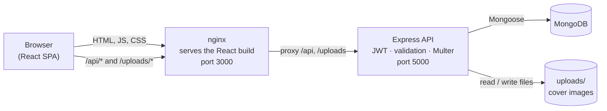
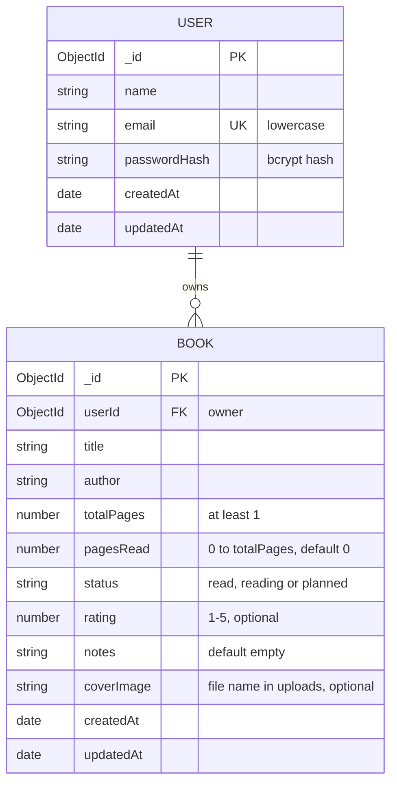
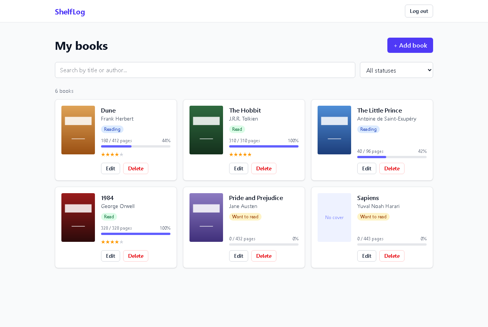
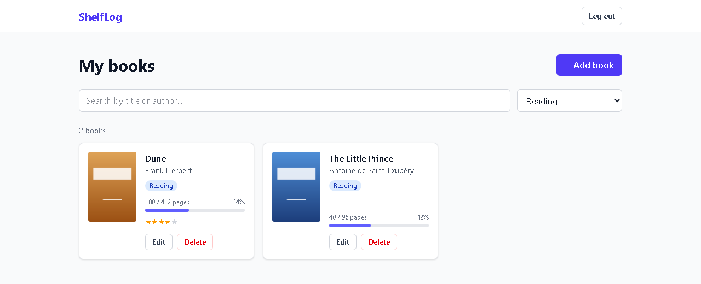
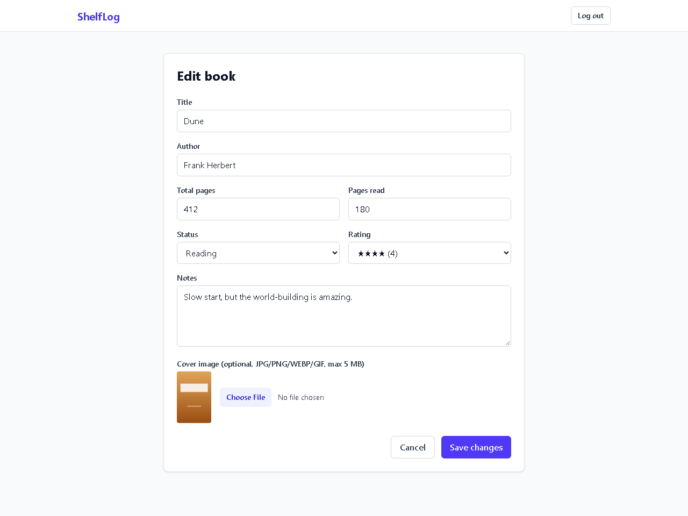
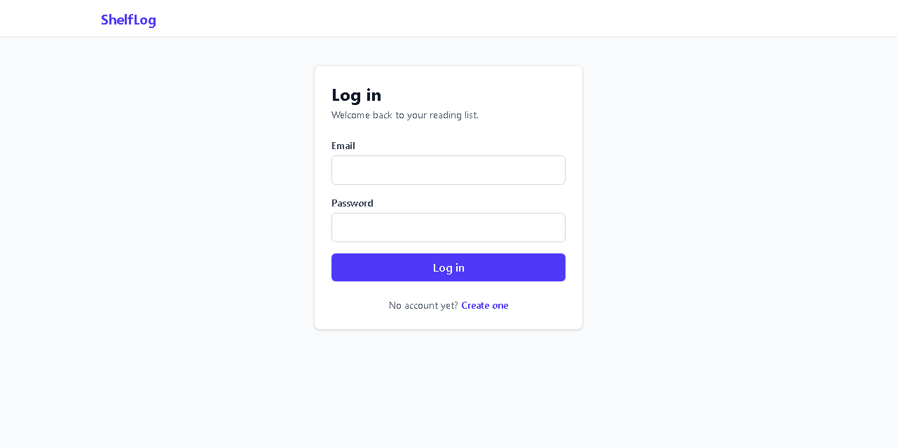
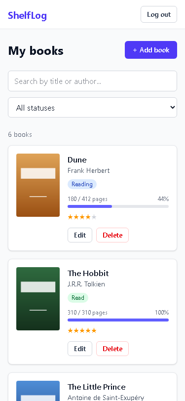

# 📚 ShelfLog – Personal Book Tracker

ShelfLog is a web application that helps readers keep track of their personal reading. Users can register, add books to their personal shelf and organise them by status: **read**, **reading** or **planned**. For each book they can record reading progress, a rating and personal notes. The app is aimed at hobby readers and students who want a simple, private place to manage their reading lists.

> Semester project for the courses *Web Application* and *Web Programming*.

## ✨ Features

- User registration and login (JWT authentication)
- Add a new book (title, author, total pages, status, optional cover image)
- View a list of your own books
- Edit a book (status, pages read, rating, notes)
- Delete a book
- Filter books by status and search by title or author

## 🛠️ Tech Stack

| Layer | Technology |
|---|---|
| Frontend | React + Vite + TypeScript + Tailwind CSS + Axios + React Router |
| Backend | Node.js + Express.js (TypeScript) + JWT + Multer + bcrypt |
| Database | MongoDB (Mongoose) |
| DevOps | Docker, Docker Compose, nginx |
| Tools | Git, GitHub Projects, Postman, VS Code |

## 🏗️ Architecture

ShelfLog is a single-page application (SPA) with a REST API:

- The **frontend** (React) runs in the browser. It shows the pages and calls the API with Axios, sending the JWT in the `Authorization` header.
- The **backend** (Express) checks the JWT, validates the data, saves it in **MongoDB** with Mongoose and stores cover images on disk (`uploads/`) with Multer.
- With Docker, **nginx** serves the built React files and forwards `/api` and `/uploads` to the backend, so the browser only talks to one address (no CORS needed). In development, the Vite dev server does the same job with its proxy.



Request flow example – *add a book*: the form sends `POST /api/books` (multipart) → nginx forwards it to Express → the `auth` middleware checks the token → Multer saves the cover in `uploads/` → the controller validates the fields and saves the book with the user's id → `201` with the new book → the React app goes back to the list.

## 🗃️ Data Model

Each user owns many books (1–N). Every book query includes the logged-in user's id, so users only see their own books.



## 📁 Project Structure

```
book-tracker/
├── backend/             # Express REST API (TypeScript)
├── frontend/            # React SPA (Vite + TypeScript)
├── docs/TESTING.md      # Test strategy and test cases
├── docs/postman/        # Postman collection for the API
├── docs/screenshots/    # Screenshots used in this README
├── docker-compose.yml   # MongoDB + backend + frontend
└── README.md
```

## 🚀 Getting Started

### 1. Clone the repository

```bash
git clone https://github.com/eduantunes266/book-tracker.git
cd book-tracker
```

### 2. Create `backend/.env` (required for both options)

The backend reads its settings from `backend/.env`. This file is not in Git (it contains secrets), so create it from the example:

```bash
# macOS / Linux / Git Bash
cp backend/.env.example backend/.env
```

```powershell
# Windows PowerShell
Copy-Item backend/.env.example backend/.env
```

Then open `backend/.env` and set **`JWT_SECRET`** to a long random string (it signs the login tokens). You can generate one with:

```bash
# macOS / Linux / Git Bash
openssl rand -hex 32
```

```powershell
# Windows PowerShell
$b = New-Object byte[] 32; [Security.Cryptography.RandomNumberGenerator]::Create().GetBytes($b); ($b | ForEach-Object { $_.ToString('x2') }) -join ''
```

For **Option 2** also set `MONGODB_URI` to your MongoDB Atlas connection string. With **Option 1** (Docker) `MONGODB_URI` is not used, so it can stay as in the example. All variables are explained in the **Configuration** section below.

> If `backend/.env` is missing, `docker compose up` stops with *"env file ... backend/.env not found"*.

### Option 1 – Docker Compose (whole app)

Requires [Docker Desktop](https://www.docker.com/products/docker-desktop/) (running). Starts MongoDB, the backend and the frontend in containers:

```bash
docker compose up --build
```

The first build takes a few minutes. When the log shows `Server running on http://localhost:5000`, open **http://localhost:3000** and create an account.
The Docker database is separate from MongoDB Atlas, so it starts empty. Data and cover images are kept in Docker volumes between restarts.
Stop with `Ctrl+C` or `docker compose down` (add `-v` to also delete the data).

### Option 2 – Development mode

Requires Node.js (v24) and a MongoDB Atlas connection string in `backend/.env`.

```bash
# Terminal 1 – API on http://localhost:5000
cd backend
npm install
npm run dev

# Terminal 2 – React app on http://localhost:5173
cd frontend
npm install
npm run dev
```

Open **http://localhost:5173**. In development, Vite forwards `/api` and `/uploads` to the backend (see `frontend/vite.config.ts`).

## ⚙️ Configuration

| Variable | Where | Used for | Example |
|---|---|---|---|
| `PORT` | `backend/.env` | Port of the Express API | `5000` |
| `MONGODB_URI` | `backend/.env` | MongoDB connection string (development). In Docker it is replaced by `mongodb://mongo:27017/shelflog` (see `docker-compose.yml`) | `mongodb+srv://<user>:<password>@<cluster>/shelflog` |
| `JWT_SECRET` | `backend/.env` | **Required.** Secret used to sign and check the login tokens. Use a long random string and keep it private | `3f9a…` (64 random hex characters) |
| `VITE_API_URL` | `frontend/.env` (optional) | Base URL of the API used by the React app. Leave it empty to use `/api` (Vite proxy in development, nginx in Docker). Only needed if the API runs on another address | empty, or `http://localhost:5000/api` |

Examples of both files: `backend/.env.example` and `frontend/.env.example`. Never commit the real `.env` files.

Fixed values (not configurable): token lifetime 1 day, cover images max 5 MB (JPG, PNG, WEBP, GIF), Docker app port 3000.

## 📸 Screenshots

**Book list** – progress, status, rating and cover for each book



**Filter by status and search by title or author**



**Add / edit a book** – with optional cover image



**Login and mobile view**

<p>
  
  
</p>

## 📡 API Documentation

Base URL: `/api` (in development `http://localhost:5000/api`).
Request and response bodies are JSON. Creating and updating books also accepts `multipart/form-data`, so a cover image can be sent in the same request.
A ready-to-use **Postman collection** with all endpoints (plus examples of 400/401 errors) is in [`docs/postman/ShelfLog.postman_collection.json`](docs/postman/ShelfLog.postman_collection.json). Import it in Postman, run **Auth → Login** and the token is saved automatically for the Books requests.

Every error response has the same shape:

```json
{ "message": "Pages read cannot be greater than total pages" }
```

### Authentication

| Method | Endpoint | Body | Success response |
|---|---|---|---|
| POST | `/api/auth/register` | `{ "name", "email", "password" }` – password at least 6 characters | `201` `{ token, user }` |
| POST | `/api/auth/login` | `{ "email", "password" }` | `200` `{ token, user }` |

```json
{
  "token": "eyJhbGciOiJIUzI1NiIsInR5cCI6IkpXVCJ9...",
  "user": { "id": "6af3...", "name": "Demo Reader", "email": "demo@example.com" }
}
```

The token is valid for 1 day. Send it on every `/api/books` request:

```
Authorization: Bearer <token>
```

### Books

All book routes require the token. Users can only see and change their own books (another user's book returns `404`).

| Method | Endpoint | Description | Success response |
|---|---|---|---|
| GET | `/api/books` | List your books, newest first. Optional query: `status=read\|reading\|planned`, `search=<text>` (title or author, case-insensitive) | `200` `Book[]` |
| GET | `/api/books/:id` | Get one book | `200` `Book` |
| POST | `/api/books` | Create a book (optional `cover` file) | `201` `Book` |
| PUT | `/api/books/:id` | Update only the fields that are sent; a new `cover` replaces the old one | `200` `Book` |
| DELETE | `/api/books/:id` | Delete the book and its cover image | `200` `{ "message": "Book deleted" }` |

**Book fields**

| Field | Type | Rules |
|---|---|---|
| `title` | string | required |
| `author` | string | required |
| `totalPages` | integer | required, at least 1 |
| `pagesRead` | integer | 0 or more, not more than `totalPages` (default `0`) |
| `status` | string | `read`, `reading` or `planned` (default `planned`) |
| `rating` | integer or `null` | 1–5, optional – `null` (or `""` in a form) removes it |
| `notes` | string | optional |
| `cover` | file (multipart only) | JPG, PNG, WEBP or GIF, max 5 MB |

Responses also include `_id`, `userId`, `coverImage` (file name, served at `/uploads/<coverImage>`), `createdAt` and `updatedAt`.

Example – create a book with a cover:

```bash
curl -X POST http://localhost:5000/api/books \
  -H "Authorization: Bearer <token>" \
  -F title="The Hobbit" -F author="J.R.R. Tolkien" \
  -F totalPages=310 -F pagesRead=120 -F status=reading -F rating=5 \
  -F cover=@hobbit.png
```

### Status codes

| Code | When |
|---|---|
| `200` | Read, update or delete succeeded |
| `201` | User or book created |
| `400` | Invalid data (e.g. missing title, `pagesRead` > `totalPages`, invalid status, wrong image type or larger than 5 MB, malformed JSON) |
| `401` | Missing, invalid or expired token; wrong email or password |
| `404` | Book not found (or it belongs to another user); unknown route |
| `409` | Email is already registered |
| `500` | Unexpected server error |

### How the frontend uses the API

All API calls are in `frontend/src/api/` (`authApi.ts`, `booksApi.ts`). An Axios interceptor adds `Authorization: Bearer <token>` to every request; if a request with a token gets `401`, the user is logged out automatically.

| Page (route) | Endpoint(s) | When |
|---|---|---|
| Login (`/login`) | `POST /api/auth/login` | Submit the login form → token saved in `localStorage` |
| Register (`/register`) | `POST /api/auth/register` | Submit the register form → token saved, user is logged in |
| My books (`/`) | `GET /api/books?status=&search=` | On page load and whenever the status filter or the search text changes (300 ms after typing stops) |
| My books (`/`) | `DELETE /api/books/:id` | "Delete" button on a card, after confirmation |
| My books (`/`) | `GET /uploads/<coverImage>` | Cover image of each book card (``) |
| Add book (`/books/new`) | `POST /api/books` (multipart) | Submit the form, with the optional cover image |
| Edit book (`/books/:id/edit`) | `GET /api/books/:id` | Load the book to fill the form |
| Edit book (`/books/:id/edit`) | `PUT /api/books/:id` (multipart) | "Save changes", with an optional new cover |

## 🧪 Testing

- Test strategy and the full list of test cases with results: [`docs/TESTING.md`](docs/TESTING.md)
- Postman collection with all endpoints and test scripts: [`docs/postman/ShelfLog.postman_collection.json`](docs/postman/ShelfLog.postman_collection.json)
- Screenshots of the API tests run in Postman (register, login, create, list, filter, update, delete, 400 error): [`docs/postman-api-tests.pdf`](docs/postman-api-tests.pdf)

The API was tested with the Postman collection and extra error requests; the frontend with manual test cases in the browser (desktop and phone width).

## ⚠️ Known Limitations

- **No automated test suite** – tests are the Postman collection and manual test cases.
- **No pagination** – all books of a user are loaded at once (fine for a personal list).
- **Token in `localStorage`** – simple, but readable by JavaScript if the page had an XSS bug. There is no refresh token: after 1 day the user must log in again.
- **Account management is minimal** – no password reset, no profile editing, no account deletion.
- **Cover images** are stored on the server's disk (or a Docker volume) and are public to anyone who knows the file name. The file type is checked from the upload's MIME type, not from the file content.
- **Separate databases** – development uses MongoDB Atlas, Docker uses its own MongoDB container, so data is not shared between them.
- **No rate limiting** on login/register.

## 🔮 Future Improvements

- Automated tests: Jest + Supertest for the API, Vitest / Playwright for the frontend.
- Pagination and sorting options (title, author, date added) in the book list.
- Reading statistics (books read per year, pages read).
- Resize and check cover images on upload; store them in cloud storage.
- Safer sessions: httpOnly cookie or refresh tokens, rate limiting on login.
- Password reset and profile page.

## 📋 Project Management

- **Project board:** [GitHub Project](https://github.com/users/eduantunes266/projects/1)

## 🗺️ Roadmap

- [x] **Milestone 1** – Concept and project setup
- [x] **Milestone 2** – Backend: REST API, database, authentication
- [x] **Milestone 3** – Frontend, Docker Compose, final documentation
